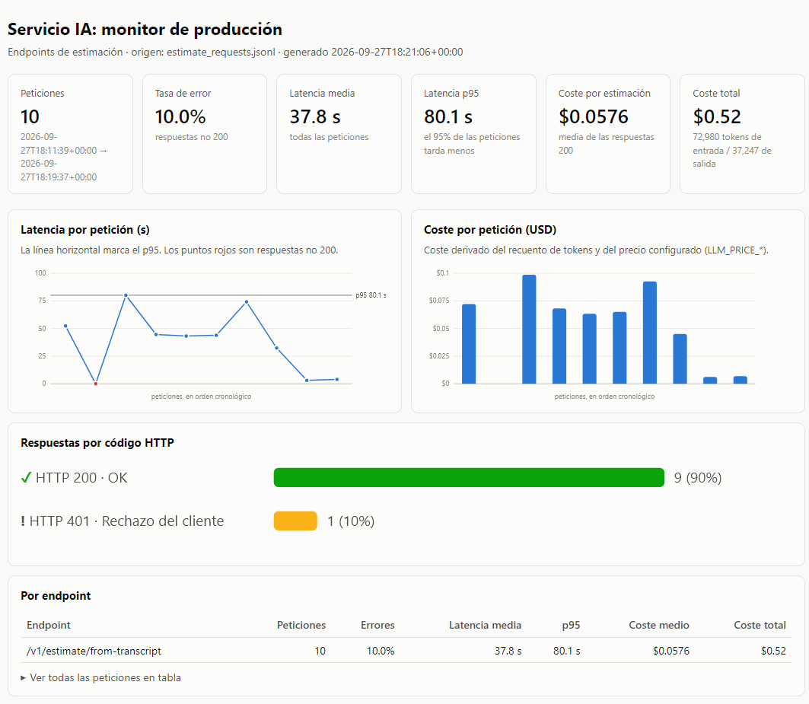

# `ai-service/eval/`: evaluación de extremo a extremo (Sesión 16)

| Fichero | Qué es |
|---|---|
| `golden_set.json` | Casos de referencia: transcripción → estimación esperada y rango aceptable |
| `run_eval.py` | Harness que lanza el golden set contra el servicio IA desplegado y calcula las métricas |
| `reports/` | Informe JSON de cada ejecución (`eval-YYYYMMDD-HHMMSS.json`). La serie histórica sirve para detectar regresiones |
| `reports/dashboard.png` | Captura del dashboard de producción tomada durante la ejecución de ejemplo (ver abajo) |
| `dashboard.py` | Genera el dashboard de producción a partir del JSONL de métricas del servicio |

Cómo lanzarlo y cómo leer los resultados: [docs/evaluation.md](../../docs/evaluation.md).

## Ejecución de ejemplo (27/09/2026)

| Evidencia | Contenido |
|---|---|
| [reports/eval-20260927-181937.json](reports/eval-20260927-181937.json) | Informe del golden set con `claude-sonnet-5`: 8/8 casos, `within_range_rate` 1,0, `mean_absolute_error` 17,8 días, `abstention_correct` true, p95 80 s |
| [reports/dashboard.png](reports/dashboard.png) | Dashboard del mismo tráfico, generado a las 18:21 UTC |

**Qué muestra la captura.** Son las 10 peticiones reales a `/v1/estimate/from-transcript`, entre las 18:11 y las 18:19 UTC:
- una prueba previa del harness con case-002;
- una petición **sin token**, lanzada a propósito para comprobar que los 401 se registran;
- los 8 casos del golden set.

| Panel | Valor | Lectura |
|---|---|---|
| Tasa de error | 10,0 % | Es el 401 intencionado (barra ámbar, «Rechazo del cliente»). No hubo ningún 502 |
| Latencia media / p95 | 37,8 s / 80,1 s | En la serie temporal, el punto rojo es el 401. Los dos puntos finales, cerca de 0, son las abstenciones de case-007 y case-008: el retrieval no encuentra nada y no se llama al generador |
| Coste por estimación / total | 0,0576 $ / 0,52 $ | 72.980 tokens de entrada y 37.247 de salida. El hueco en las barras es el 401, que no consume tokens |

La versión final de la captura está en [docs/img/dashboard.png](../../docs/img/dashboard.png). Son los mismos datos, con el intervalo de fechas abreviado y el panel HTTP a escala.

## No confundir con `ai-service/scripts/golden_set.json` (Sesión 10)

| | `scripts/golden_set.json` (Sesión 10) | `eval/golden_set.json` (Sesión 16) |
|---|---|---|
| Qué mide | Solo el **retrieval**: si los chunks recuperados pertenecen a los presupuestos relevantes | El **sistema completo**: reformulación → retrieval → LLM → validación |
| Entrada | Query corta (`query`) | Transcripción de reunión (`transcript` o `transcript_file`) |
| Verdad de referencia | `relevant_budget_ids` | `expected_engineer_days` + `acceptable_range`, o `expect_abstention` |
| Métrica | Precision@k, latencia de búsqueda | `within_range_rate`, `mean_absolute_error`, `abstention_correct`, latencia |
| Cómo se ejecuta | `scripts/measure_retrieval.py`, en proceso y sin LLM | `eval/run_eval.py`, por HTTP contra el servicio real, **con LLM y consumo de tokens** |

Los dos se mantienen: uno diagnostica el retrieval de forma aislada y barata, y el otro mide lo que recibe el usuario.

## Esquema de un caso

| Campo | Obligatorio | Significado |
|---|---|---|
| `id` | sí | Identificador estable (`case-NNN`). No se reutiliza nunca, para poder comparar informes |
| `transcript` / `transcript_file` | uno de los dos | Texto de la reunión, o ruta relativa a la raíz del repo. Mínimo 100 caracteres, como exige el endpoint |
| `expected_engineer_days` | sí (`null` en abstención) | Valor central esperado, en días-ingeniero, la unidad del `Estimate` |
| `acceptable_range` | sí (`null` en abstención) | `[min, max]` inclusivo. El caso pasa si la estimación cae dentro |
| `expect_abstention` | sí | `true`: lo correcto es **no** dar cifra (`confidence="insufficient"` o `total_engineer_days=null`) |
| `allow_abstention` | no | Solo en casos de borde: abstenerse también cuenta como acierto |
| `expected_confidence` | no | Nivel de confianza esperado. Es informativo: se registra, pero no decide si el caso pasa |
| `expected_budget_ids` | no | Presupuestos históricos en los que se basa el valor esperado. Documenta el criterio (ver limitación más abajo) |
| `difficulty`, `notes` | no | Tipo de caso y cálculo del valor esperado |

## Criterio para fijar los valores esperados

Los valores no se fijan a ojo. Salen del **corpus histórico que realmente está indexado** (`ai-service/data/budgets_sample_es.json`, 15 presupuestos y 52 chunks):

1. Se identifican los componentes históricos que cubren el alcance que pide la transcripción.
2. Se suman sus horas y se dividen entre 8 h/día → `expected_engineer_days`.
3. El rango aceptable es aproximadamente **×0,6 a ×1,7** del valor esperado, redondeado. Se amplía en los casos ambiguos o de borde. La asimetría es deliberada: en consultoría es más frecuente infraestimar que sobreestimar.
4. Los casos de abstención tratan de temas **ausentes del corpus**: restauración, sector público y mainframe/COBOL.

| Caso | Tipo | Base histórica | Esperado |
|---|---|---|---|
| case-001 | Fácil | BUD-2024-005 + INV-003 (BUD-2024-007): 580 h | 73 d [45, 125] |
| case-002 | Fácil | BUD-2024-001: 480 h | 60 d [36, 100] |
| case-003 | Medio-alto | BUD-2024-013: 500 h | 63 d [38, 105] |
| case-004 | Medio-alto | BUD-2024-002: 520 h | 65 d [39, 110] |
| case-005 | Ambiguo | APPT-002 + VIDEO-003 (BUD-009) + ALERT-002 (BUD-010): 460 h | 58 d [30, 110] |
| case-006 | Borde | WMS-001 + TELE-001 (+ CATALOG-001): 390 a 540 h | 70 d [30, 150], o abstención |
| case-007 | Abstención | — (ERP sin documentar, restauración) | sin cifra |
| case-008 | Abstención | — (mainframe COBOL, sector público) | sin cifra |

**Regla de mantenimiento:** los rangos se recalibran solo cuando cambia el corpus o el criterio de negocio, nunca para que una ejecución «apruebe». Todo cambio se anota en `notes` y en el commit.

## Protección de datos

- Las transcripciones inline son **sintéticas** y solo identifican a las personas por su rol.
- Las tres transcripciones reutilizadas (`business-backend/examples/transcripts/`) son ficticias.
- No se usa `ai-service/data/seed/`, que contiene datos de contacto. Así se cumplen el RGPD y la LOPDGDD.

## Limitación conocida

La respuesta de `/v1/estimate/from-transcript` cita las fuentes por **id de chunk** (`sources[].source_id`) y no incluye el `budget_id`. Por eso el harness no comprueba `expected_budget_ids` automáticamente: mide `grounded`, es decir, si hay al menos una fuente citada en las estimaciones con cifra. Mapear chunk → budget obligaría a consultar la base de datos vectorial y queda como mejora futura.
