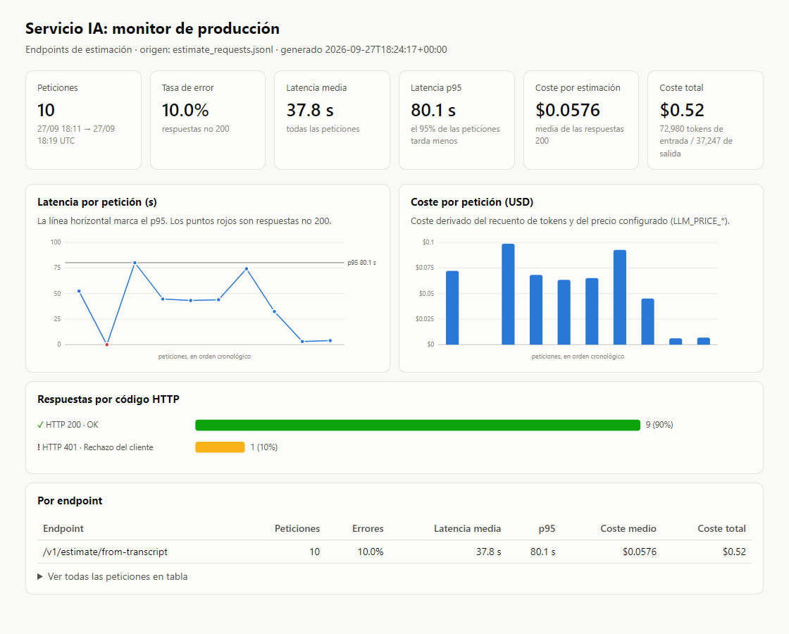

# Evaluación y monitorización del servicio IA (Sesión 16)

**Resumen.** El smoke test de la Sesión 15 comprueba que el sistema *responde*. Esta sesión añade dos formas de comprobar que responde *bien*:
- un **golden set** con su harness, que lanzamos nosotros y mide la calidad frente a respuestas de referencia;
- un **dashboard de producción**, que vigila en todo momento latencia, coste y errores.

## 1. Qué hay y dónde

| Pieza | Ruta |
|---|---|
| Golden set (8 casos, 2 de abstención) | [ai-service/eval/golden_set.json](../ai-service/eval/golden_set.json) |
| Criterio de cada caso y esquema | [ai-service/eval/README.md](../ai-service/eval/README.md) |
| Harness | [ai-service/eval/run_eval.py](../ai-service/eval/run_eval.py) |
| Informes de cada ejecución | [ai-service/eval/reports/](../ai-service/eval/reports/) |
| Instrumentación de métricas | [ai-service/app/observability.py](../ai-service/app/observability.py), enganchada en `app/main.py` y `app/services/llm_service.py` |
| Dashboard (generador) | [ai-service/eval/dashboard.py](../ai-service/eval/dashboard.py) |
| Captura del dashboard | [docs/img/dashboard.png](img/dashboard.png) |

> **Dos golden sets distintos.** `ai-service/scripts/golden_set.json` es de la **Sesión 10**: evalúa solo el *retrieval* (precision@k por `budget_id`), en proceso y sin LLM, con `scripts/measure_retrieval.py`. El de `ai-service/eval/` es de la **Sesión 16**: evalúa el sistema *completo* por HTTP, con el LLM real. Se mantienen los dos. La comparativa detallada está en [ai-service/eval/README.md](../ai-service/eval/README.md#no-confundir-con-ai-servicescriptsgolden_setjson-sesión-10).

## 2. Lanzar la evaluación

> **Coste.** Cada ejecución hace 8 llamadas reales a `/v1/estimate/from-transcript`, con reformulación y generación en Claude Sonnet 5. Tarda unos 10 minutos y cuesta unos céntimos de dólar; el coste exacto aparece en el dashboard. El gasto es pequeño y deliberado, pero no conviene lanzarlo en bucle.

El servicio IA no publica puertos (Sesión 15). Para llegar a él desde el host se usa el override dev, que publica `:8000`:

```powershell
# raíz del repo
docker compose -f docker-compose.yml -f docker-compose.dev.yml up -d --wait

# ai-service/ — el token se lee del entorno, nunca del código
cd ai-service
$env:AI_SERVICE_TOKEN = (Select-String '^AI_SERVICE_TOKEN=' ..\.env).Line.Split('=',2)[1]
# $env:ESTIMATE_API_KEY = ...   # solo si el servicio la exige
uv run python eval/run_eval.py                          # todo el set
uv run python eval/run_eval.py --only case-007          # un caso suelto
```

| Variable / opción | Por defecto | Uso |
|---|---|---|
| `AI_SERVICE_URL` | `http://localhost:8000` | Servicio contra el que se evalúa (staging o producción) |
| `AI_SERVICE_TOKEN` | — | Cabecera `X-Service-Token` |
| `ESTIMATE_API_KEY` | vacío | Cabecera `X-API-Key`, si está activada |
| `--timeout` | 240 s | Tiempo máximo por petición. Solo la generación con Sonnet 5 ya tarda unos 80 s |
| `--reports-dir` | `eval/reports/` | Dónde se guarda `eval-YYYYMMDD-HHMMSS.json` |

El progreso de cada caso aparece en stderr (`PASS`/`FAIL`). En stdout sale el informe JSON, que además se guarda en `eval/reports/`.

## 3. Leer el informe

Ejecución de ejemplo: [eval-20260927-181937.json](../ai-service/eval/reports/eval-20260927-181937.json), con `claude-sonnet-5` y el corpus en español.

```json
"metrics": {
  "within_range_rate": 1.0,       // aciertos: estimaciones dentro del rango aceptable
  "mean_absolute_error": 17.8,    // error medio en días-ingeniero frente al esperado
  "abstention_correct": true,     // ¿se abstuvo en TODOS los casos sin datos?
  "abstention_rate": 1.0,
  "mean_latency_ms": 40695.7,
  "p95_latency_ms": 80153.7,
  "error_rate": 0.0,              // respuestas no 200
  "grounded_rate": 1.0,           // estimaciones con cifra que citan al menos una fuente
  "n_cases": 8, "n_passed": 8
}
```

| Caso | Esperado | Obtenido | Confianza | Lectura |
|---|---|---|---|---|
| case-001 fácil | 73 [45, 125] | 111 | medium | Pasa, pero con +38 días: está en el 85 % del rango |
| case-002 fácil | 60 | 60 | medium | Exacto |
| case-003 medio-alto | 63 | 62 | high | Casi exacto |
| case-004 medio-alto | 65 | 65 | high | Exacto |
| case-005 ambiguo | 58 [30, 110] | 108 | low | Pasa **por 2 días**; la confianza baja es coherente con la ambigüedad |
| case-006 borde | 70, o abstención | abstención | insufficient | Correcto: el cliente no ha decidido el alcance |
| case-007 abstención | sin cifra | abstención | insufficient | Correcto, en 3 s (el retrieval no encuentra nada y no se llama al generador) |
| case-008 abstención | sin cifra | abstención | insufficient | Correcto, en 4 s |

**Lectura.** Aunque pasan los 8 casos, eso no significa que el sistema esté perfecto:
- Los casos con un precedente casi 1:1 (002, 003 y 004) se clavan.
- Los casos con **alcance compuesto** (001 y 005) se **sobreestiman** en torno a un +50–85 % y rozan el límite superior del rango. `mean_absolute_error` (17,8) detecta ese sesgo aunque `within_range_rate` no lo haga.
- Es la primera señal que conviene vigilar en las siguientes ejecuciones. Los rangos **no** se han tocado para absorberla.

- Una **estimación pasa** si `total_engineer_days` cae dentro de `acceptable_range`, no si coincide exactamente. En los casos de borde (`allow_abstention`) también pasa si el sistema se abstiene.
- Una **abstención pasa** si el sistema devuelve `confidence="insufficient"` o `total_engineer_days=null`. Es la señal de seguridad: una cifra inventada para un proyecto sin precedentes es peor que no dar ninguna.
- Un error HTTP no cuenta nunca como acierto, tampoco en un caso de abstención.
- **Para detectar regresiones**, se compara el informe nuevo con el anterior de `eval/reports/`, caso a caso. Hay que comprobar que coinciden `golden_set_sha256` y `model`: si alguno cambia, las cifras no son comparables. Criterio orientativo: bloquear el cambio (de prompt, modelo o `RAG_*`) si `abstention_correct` pasa a `false` o si `within_range_rate` baja más de un caso.

## 4. Dashboard de producción

### Qué se emite

- Cada petición a un endpoint de estimación deja un evento `estimate_request` en el log estructurado y una línea en `/app/metrics/estimate_requests.jsonl`, dentro del volumen `metrics_data`.
- Los endpoints instrumentados son:
  - `/v1/estimate/from-transcript` (RAG);
  - `/api/v1/estimate`, `/api/v1/estimate/stream` y `/api/v1/sessions/{session_id}/estimate` (CAG).

| Campo | Origen |
|---|---|
| `latency_ms` | El middleware más externo lo mide hasta el **último byte** de la respuesta, así que en streaming incluye toda la generación |
| `prompt_tokens`, `completion_tokens`, `llm_calls` | Suma del `usage` de **todas** las llamadas al LLM de la petición: reformulación, generación y reintentos de validación |
| `estimated_cost_usd` | Tokens × `LLM_PRICE_INPUT/OUTPUT_PER_MTOK_USD`. Por defecto, los precios de Sonnet 5: 2 $ y 10 $ por millón |
| `status_code` | Incluye los 401 del token de servicio y los 502 del pipeline |

### Generarlo

```powershell
cd ai-service
docker compose cp ai-service:/app/metrics/estimate_requests.jsonl eval/metrics/
uv run python eval/dashboard.py                       # -> eval/dashboard/dashboard.html
uv run python eval/dashboard.py --since 2026-09-27T00:00 --endpoint /v1/estimate/from-transcript
```

El resultado es un HTML autocontenido, sin dependencias ni CDN, que se abre en cualquier navegador. No incluimos Logfire ni LangSmith porque no están integrados en este repositorio. El JSONL tiene un formato plano, así que se podría llevar a cualquiera de los dos más adelante sin tocar la instrumentación.



La captura recoge el tráfico real de la verificación del 27/09:
- una prueba del harness con case-002;
- una petición **sin token**, lanzada a propósito para comprobar que los 401 se registran (es el 10 % de error);
- la ejecución completa del golden set.

En total, 10 peticiones, 0,52 $ y un p95 de 80 s. Los dos casos de abstención aparecen al final, con coste y latencia casi nulos.

### Cómo leerlo

| Panel | Qué vigilar | Por qué |
|---|---|---|
| **Tasa de error** | Cualquier valor por encima de 0 merece revisión. Los 401 apuntan a un token mal configurado en un cliente; los 502, a que el LLM falla o devuelve JSON inválido | Un 502 es una estimación que el usuario no recibe |
| **Latencia media y p95** | El p95, no la media: con unos 80 s por estimación, el p95 dice cuánto espera el usuario en los peores casos. Una subida brusca suele deberse a reintentos de validación o a que el router ha saltado a un fallback | Latencia |
| **Coste por estimación** | Estabilidad. Si sube sin que cambie el tráfico, lo normal es que el modelo esté pensando más, que haya más reintentos o que el contexto sea más grande | El coste lo paga cada respuesta |
| **Por endpoint** | Separa el RAG de los CAG, que tienen perfiles de coste y latencia muy distintos | — |

### La trampa del `/health`

`/health` **no llama al modelo ni a la base de datos**, y es así a propósito ([main.py](../ai-service/app/main.py)). Docker lo consulta cada 15 s: si llamara al LLM, cada comprobación costaría tokens, un corte del proveedor reiniciaría contenedores que están sanos, y aun así no diría nada de la *calidad* de las respuestas. El reparto es este:

- `/health` responde si el proceso está vivo;
- el **dashboard** muestra cómo se comporta el modelo con el tráfico real;
- el **golden set** mide si responde bien.

## 5. Limitaciones

- La respuesta cita las fuentes por id de chunk, no por `budget_id`. Por eso `expected_budget_ids` documenta el criterio pero no se comprueba automáticamente. En su lugar se mide `grounded_rate`.
- Con 8 casos, cada caso vale un 12,5 % del total. El set sirve para detectar regresiones gruesas, no diferencias finas entre dos prompts parecidos.
- El coste es una **estimación** a precio de lista. La facturación real puede diferir: caché de prompts, descuentos, etc.
- Las métricas en fichero no rotan. En un despliegue real irían a un colector (Logfire, Loki…) o necesitarían rotación.
